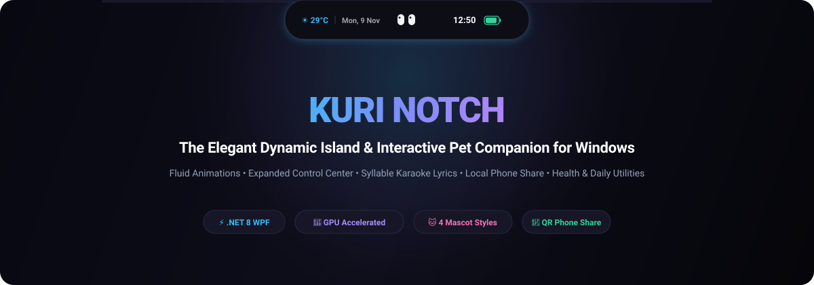

<p align="center">
  
</p>

<p align="center">
  <strong>The Elegant Dynamic Island & Interactive Pet Companion for Windows 10 & 11</strong>
</p>

<p align="center">
  <a href="https://github.com/Rikuuu01/Kuri-Notch/releases/latest"></a>
  <a href="https://dotnet.microsoft.com/download/dotnet/8.0"></a>
  <a href="#"></a>
  <a href="#"></a>
  <a href="LICENSE"></a>
</p>

<p align="center">
  <a href="#-quick-download">⚡ Download</a> •
  <a href="#-mascot-companions">🐱 Mascots</a> •
  <a href="#-features">✨ Features</a> •
  <a href="#-installation-guide">📦 Installation</a> •
  <a href="#-hotkeys--shortcuts">⌨️ Hotkeys</a> •
  <a href="#-tech-stack">🛠️ Tech Stack</a>
</p>

---

## 🌟 Overview

**Kuri** brings the fluid, modern **Dynamic Island** experience to Windows with hardware-accelerated animations, intelligent utility hubs, and living, emotive desktop mascots. Designed natively with **.NET 8 WPF**, Kuri floats smoothly at the top edge of your screen, morphing dynamically based on what you are doing — from streaming music with synchronized syllable karaoke lyrics, to controlling quick device settings without leaving your active window.

---

## ⚡ Quick Download

| Package Type | Architecture | Download Link | Description |
| :--- | :---: | :--- | :--- |
| **Setup Installer** *(Recommended)* | **x64 (64-bit)** | [⬇️ **Kuri-v1.1-Setup-x64.exe**](release/Kuri-v1.1-win-x64.zip) | Full wizard installer with autostart and Start Menu shortcuts |
| **Setup Installer** | **x86 (32-bit)** | [⬇️ **Kuri-v1.1-Setup-x86.exe**](release/Kuri-v1.1-win-x86.zip) | For 32-bit Windows devices and lightweight tablets |
| **Portable ZIP** | **x64 (64-bit)** | [⬇️ **Kuri-v1.1-win-x64.zip**](release/Kuri-v1.1-win-x64.zip) | Standalone portable executable. Extract and run `NotchWin.exe` |
| **Portable ZIP** | **x86 (32-bit)** | [⬇️ **Kuri-v1.1-win-x86.zip**](release/Kuri-v1.1-win-x86.zip) | Standalone portable 32-bit executable |

---

## 🐱 Mascot Companions

Kuri features **interactive, reactive desktop pets** that live inside your notch. In **Idle Mode**, the mascot sits right at the **exact center of the notch island**, blinking, sleeping when you are inactive, and happily bobbing along to music.

<p align="center">
  <table>
    <tr>
      <td align="center" width="25%">
        <br>
        <strong>🥟 Pastel Mochi</strong><br>
        <em>Soft, bouncy, and cute. Puts on DJ headphones when music plays and squashes with joy.</em>
      </td>
      <td align="center" width="25%">
        <br>
        <strong>🚀 Astro Mascot</strong><br>
        <em>Futuristic cosmonaut with a glowing visor, reactive antenna, and cyber pulse glow.</em>
      </td>
      <td align="center" width="25%">
        <br>
        <strong>🥚 Egg Mascot</strong><br>
        <em>Minimalist shell character with gentle Zen expressions, serene winks, and calm idle states.</em>
      </td>
      <td align="center" width="25%">
        <br>
        <strong>👀 Notch Eyes</strong><br>
        <em>Embedded island cyber eyes. Glances at your cursor, blinks naturally, and flashes when taking screenshots.</em>
      </td>
    </tr>
  </table>
</p>

- **Centered Idle Alignment**: When no music or timer is active, your chosen mascot takes center stage between the date and clock.
- **Natural Life Cycles**: Mascots blink autonomously, glance around, listen to system audio, and fall into a peaceful sleep after 5 minutes of desktop inactivity.

---

## ✨ Features

### 🎛️ 1. Expanded Control Center
Access your PC essentials directly inside the Notch without opening the Windows Settings app:
- **In-Notch Wi-Fi Expander**: Scan, view, and connect to Wi-Fi networks in a fixed-height card with live connection badges.
- **In-Notch Bluetooth Expander**: Scan and pair nearby Bluetooth peripherals and audio gear.
- **Quick Action Toggles**: Airplane Mode, Dark/Light Mode, Mic Mute, Instant Screen Capture, Screen Lock, and Task Manager launcher.
- **Sliders & Audio Output Switcher**: Precision sliders for Volume & Display Brightness with an inline drop-down-free sound output device switcher (Speakers, Headphones, FxSound, etc.).

### 🎵 2. Dynamic Media Player & Syllable-Sync Lyrics
- **Windows SMTC Sync**: Integrates automatically with Spotify, Apple Music, Tidal, YouTube Music, Chrome, and desktop players.
- **Syllable-by-Syllable Karaoke**: Powered by the **SpicyLyrics API**, **TTML**, and **LRC-RED** engines. Watch lyrics light up word-by-word in real time.
- **Collapsed Mini Karaoke**: Keep lyrics singing across your screen even when the notch is collapsed!
- **Album Art Aura**: Dynamic background glow that adapts to the album art palette.

### 📱 3. Shelf & Zero-Cable Phone Share
- **Drag & Drop Shelf**: Temporary staging area for files, images, and documents across applications.
- **Wireless Phone Share**: Generates a high-speed local HTTP Wi-Fi server with an on-screen QR code. Scan with your phone's camera to instantly view and download files on your smartphone without cables, internet uploads, or third-party cloud services.
- **Precision Responsive Layout**: Center drop zone when closed, clean dual-column layout when the QR barcode is active.

### 🌿 4. Health & Daily Companion
- **Hydration Tracker**: Set daily water intake goals, log cups with single clicks, and receive gentle water break reminders.
- **Sedentary & Posture Alerts**: Monitors continuous sitting duration and encourages short stand-and-stretch breaks.
- **Live BMKG Weather**: Real-time Indonesian meteorological data (temperature, rain forecast, weather conditions).
- **Automated Prayer Times (Jadwal Sholat)**: Accurate geographic prayer calculations with countdown timer and optional gentle adzan alerts.

### ⏱️ 5. Smart Productivity Suite
- **Clipboard History**: Pin, search, and copy recent text snippets and images.
- **Timers & Stopwatch**: Quick Pomodoro presets, custom countdowns, and precision stopwatch with lap times.
- **Fullscreen Slim Bar**: Automatically morphs into an ultra-subtle, non-intrusive 6px slim bar when watching full-screen movies or playing games.

---

## 📦 Installation Guide

### Option A: Setup Installer (Recommended)
1. Download **`Kuri-v1.1-Setup-x64.exe`** from the [Releases](release/) directory.
2. Run the installer wizard.
3. Choose whether to launch Kuri on Windows startup.
4. Enjoy! Kuri will appear gracefully at the top of your primary display.

### Option B: Portable Mode
1. Download **`Kuri-v1.1-win-x64.zip`**.
2. Extract the archive into any preferred folder (e.g. `C:\Program Files\Kuri` or `D:\Tools\Kuri`).
3. Double click **`NotchWin.exe`** to run.

---

## ⌨️ Hotkeys & Shortcuts

| Hotkey / Action | Function |
| :--- | :--- |
| **Hover Top Screen** | Automatically expands the notch smoothly |
| **`Win + Shift + N`** | Toggle expand / collapse notch from anywhere |
| **`Esc`** | Instantly collapse expanded notch |
| **Tab Numbers (`1` - `9`)** | Quick switch between notch cards (Home, Media, Weather, Sleep, Water, etc.) |
| **Middle Click on Pet** | Trigger pet affection animation (squash / wink) |
| **`Win + PrintScreen`** | Capture region and automatically dock into Shelf |

---

## 🛠️ Tech Stack & Architecture

- **Runtime & Framework**: `.NET 8.0` with Windows Presentation Foundation (`WPF`)
- **Graphics & Composition**: DirectComposition, GPU Hardware Acceleration, ClearType Subpixel Rendering
- **Audio & Media**: Windows SMTC API (`Windows.Media.Control`), NAudio core audio endpoints
- **Lyrics Providers**: SpicyLyrics REST API, Apple Music TTML Parser, LRC-RED Engine
- **Local File Server**: Lightweight asynchronous HTTP Listener with QR generator (`QRCoder`)
- **Packaging**: Inno Setup 6 for universal 64-bit and 32-bit self-contained installers

```
DynamicNotchWindows/
├── NotchWin/
│   ├── Assets/Characters/    # Mascot character graphics & avatars
│   ├── Controls/             # MochiPet, NotchEyes, Mascot controls
│   ├── Converters/           # Karaoke clipping, Visibility converters
│   ├── Services/             # BMKG, Wifi, Bluetooth, Lyrics, Volume, Battery
│   ├── ViewModels/           # Reactive MVVM Notch & Widget controllers
│   └── Views/                # NotchWindow (Main floating canvas)
├── docs/                     # Documentation & GitHub Pages web showcase
└── installer/                # Inno Setup build configurations
```

---

## 🗺️ Roadmap

- [x] Syllable-by-syllable karaoke lyrics engine
- [x] In-Notch Wi-Fi and Bluetooth network expanders
- [x] Interactive Mascot Center Alignment on Idle
- [x] Phone Share QR code transfer
- [ ] Multi-monitor independent notch placement
- [ ] Custom community pet avatar importer (.SVG / .Lottie)
- [ ] Spotify Canvas animated video background support

---

## 🤝 Contributing

Contributions are warmly welcomed! Feel free to:
1. Fork the Project (`git checkout -b feature/AmazingFeature`)
2. Commit your Changes (`git commit -m 'Add some AmazingFeature'`)
3. Push to the Branch (`git push origin feature/AmazingFeature`)
4. Open a Pull Request

---

## 📄 License

Distributed under the **MIT License**. See `LICENSE` for more information.

<p align="center">
  Crafted with ❤️ for Windows users who love clean aesthetics and dynamic fluidity.
</p>
